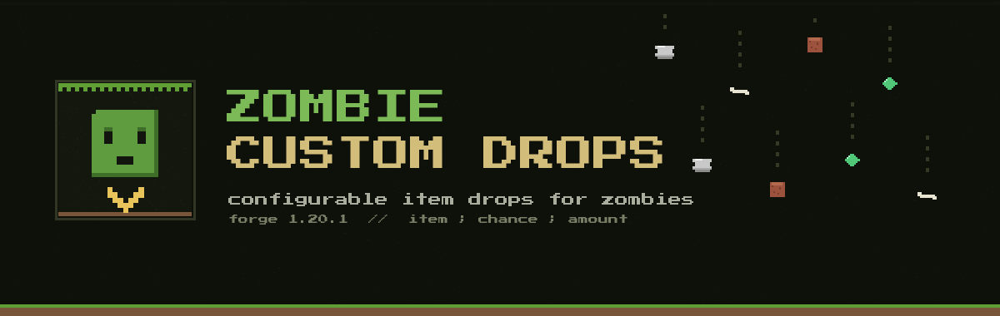

<div align="center">



# Zombie Custom Drops

**Configurable extra item drops for zombie-family mobs — item, chance, and stack size per entry.**

[](https://www.minecraft.net)
[](https://files.minecraftforge.net)
[](https://adoptium.net)
[](LICENSE)

</div>

---

Stock "zombies drop more loot" mods give you whatever the author hardcoded.
**Zombie Custom Drops** hands you the config: pick **which items**, set the
**drop chance**, choose the **stack range** — per entry, hot-reloaded, works
with vanilla and modded items alike.

## Features

- **Per-entry drop rules** — `item;chance;min;max`, each entry rolls independently
- **Per-entity tables** — prefix an entry with a mob id or tag (`drowned=...`) so only that mob drops it
- **Item NBT support** — attach SNBT to any drop: potions, enchanted gear, named quest items
- **Looting scaling** — optional `lootingChanceBonus` raises every roll per Looting level on the kill
- **Per-kill cap** — all entries roll; the winners are drawn from a hat, `maxExtraDropsPerKill` (default `1`) decides how many actually drop
- **Zombie family only** — zombie, husk, drowned, zombie villager, zombified piglin; other mobs in `entities` are refused (even via tags)
- **Modded items welcome** — any `namespace:item` id, including TaCZ ammo, mod currency, quest items
- **Entity-type tags** — `#minecraft:undead`, `#forge:zombies`, any tag you want
- **Player-kill option** — gate drops behind player kills to keep mob farms honest (pet kills count too)
- **Hot reload** — `/reload`-free: config changes apply on file save
- **Zero dependencies** — single jar, Forge only

## Configuration

`config/zombie_custom_drops-common.toml` (created on first launch):

```toml
[drops]
# Each entry rolls independently: "[entity=]item[{nbt}];chance;min;max"
#   entity = optional mob id or #tag restricting this entry
#   {nbt}  = optional NBT applied to the dropped stack
#   chance = 0.0-1.0   (0.15 = 15% chance)
#   min/max = optional stack-size range, defaults to 1
extraDrops = [
    "minecraft:rotten_flesh;0.35;1;2",    # common junk
    "minecraft:bone;0.20;1;2",
    "minecraft:coal;0.15;1;2",
    "minecraft:carrot;0.10;1;2",
    "minecraft:potato;0.10;1;2",
    "minecraft:iron_ingot;0.08;1;1",
    "minecraft:phantom_membrane;0.05;1;1",# uncommon
    "minecraft:ender_pearl;0.04;1;1",     # rare
    "minecraft:blaze_rod;0.03;1;1",       # rarest
    "minecraft:drowned=minecraft:copper_ingot;0.30;1;3",  # drowned-only drop
    "#forge:zombies=tacz:ammo;0.05;4;12",                 # modded items work too
    "minecraft:zombie=minecraft:potion{Potion:\"minecraft:healing\"};0.02"  # NBT drops
]
# Winners are drawn from all successful rolls; this caps how many drop (0 = unlimited)
maxExtraDropsPerKill = 1
# Extra chance per Looting level on the kill (0.01 = +1% per level)
lootingChanceBonus = 0.01

[filter]
# Entities that roll extra drops. Plain ids or #namespace:entity_type_tag.
# Locked to the zombie family — creeper/skeleton/etc. entries are refused.
entities = [
    "minecraft:zombie",
    "minecraft:husk",
    "minecraft:drowned",
    "minecraft:zombie_villager",
    "minecraft:zombified_piglin"
]
# true = drops only when a player (or their pet) lands the kill
requirePlayerKill = false
# true = log each rolled drop to console
debugLog = false
```

### Entry format

| Field   | Type          | Example                                        | Notes                                    |
|---------|---------------|------------------------------------------------|------------------------------------------|
| entity  | `mod:mob` or `#tag` | `minecraft:drowned=`                       | Optional prefix — entry only fires for that mob |
| item    | `mod:item`    | `tacz:ammo`                                    | Any registered item — modded included    |
| {nbt}   | SNBT          | `{Potion:"minecraft:healing"}`                 | Optional — NBT data copied onto the stack |
| chance  | `0.0`–`1.0`   | `0.08` (8%)                                    | Rolled independently per kill            |
| min/max | int           | `4;12`                                         | Stack range; omit both to default to 1   |

## Build

```
gradlew build
```

Jar lands in `build/libs/zombie_custom_drops-1.20.1-1.0.0.jar`.

## Requirements

|           |              |
|-----------|--------------|
| Minecraft | 1.20.1       |
| Forge     | 47.4.0+      |
| Java      | 17           |

## License

MIT — see [LICENSE](LICENSE).
